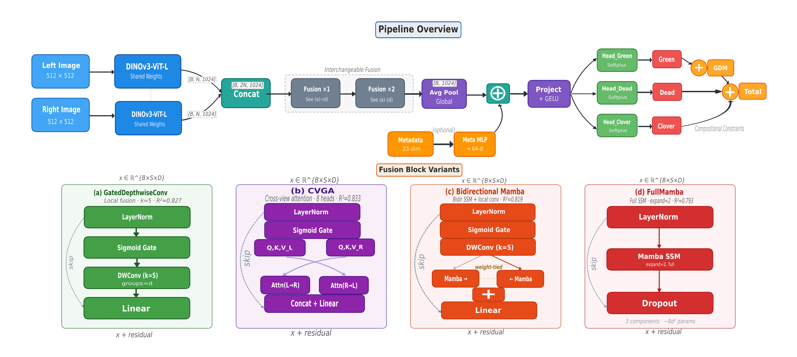
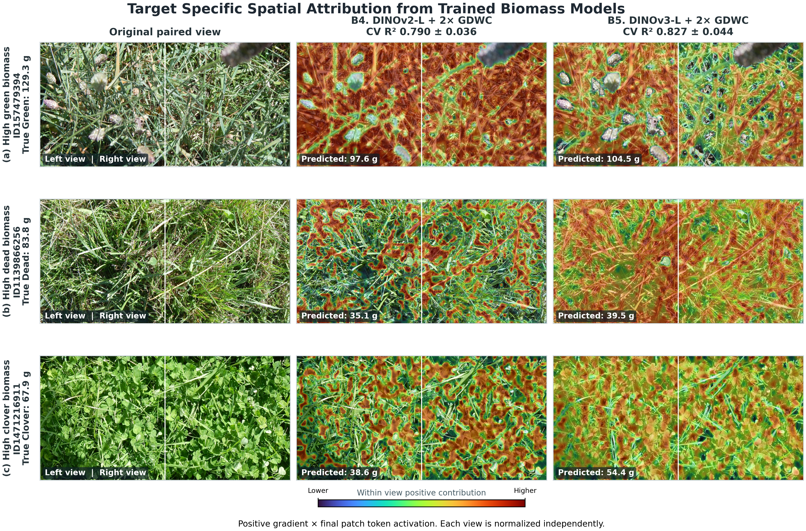
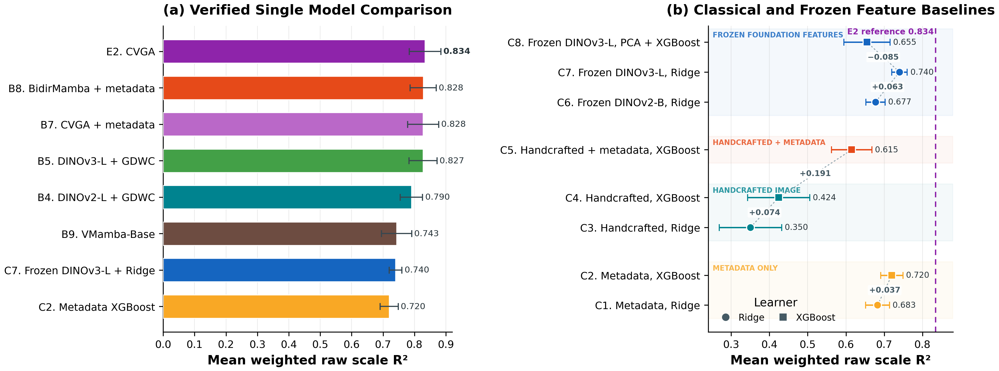
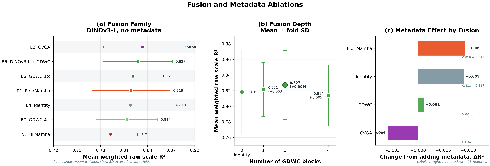
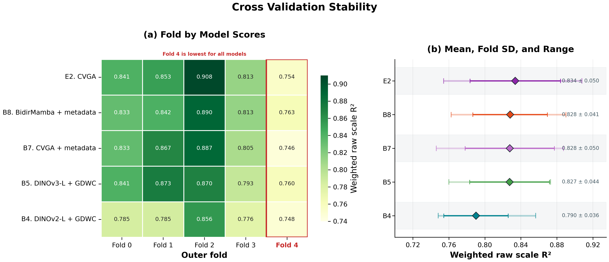
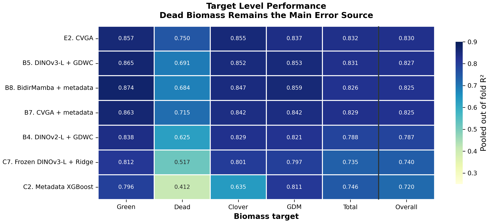

# Fusion Complexity Is Not Fusion Quality: Backbone, Cross View Fusion, and Metadata as Separate Factors in Pasture Biomass Regression:

**Author:** Mridankan Mandal.

**Paper:** [arXiv:2603.07819](https://arxiv.org/abs/2603.07819).

## Overview:

This repository contains training, evaluation, classical baseline, notebook, and figure generation code for pasture biomass regression on the CSIRO Image2Biomass dataset. The study treats backbone transfer, cross view fusion, and metadata as separate experimental factors under one locked five fold split and one raw scale weighted coefficient of determination.

The corrected evidence does not support a monotonic relation between fusion complexity and regression quality. Cross view gated attention is the strongest verified single model, while deeper convolution and full Mamba fusion are weaker. Backbone changes produce a larger observed difference than fusion depth. Metadata contains useful signal, but its effect changes with the image pathway.

## Main findings:

- E2, DINOv3 Large with cross view gated attention and no metadata, is the strongest verified single model at mean fold raw weighted R squared of `0.8338 +/- 0.0503`.
- B5, DINOv3 Large with two gated depthwise convolution blocks, reaches `0.8274 +/- 0.0443`. The matched DINOv2 Large model B4 reaches `0.7902 +/- 0.0358`.
- Fusion quality is nonmonotonic. Identity addition reaches `0.8181`, one gated depthwise block reaches `0.8213`, two blocks reach `0.8274`, four blocks reach `0.8136`, and full Mamba reaches `0.7930`.
- Metadata is not a universal gain. Across four matched DINOv3 pathways, it reduces the score range from `0.0157` to `0.0013`, but individual changes range from `-0.0061` to `+0.0093`.
- Classical metadata models remain strong controls. C2 metadata XGBoost reaches `0.7199 +/- 0.0289`.
- Frozen foundation features are linearly useful. C7 frozen DINOv3 Large Ridge reaches `0.7400 +/- 0.0203`.
- Dry Dead biomass is the hardest target across selected deep, classical, and frozen feature models.
- Fold standard deviations describe variation across outer data partitions. Most deep configurations use one training seed, so these values are not seed uncertainty estimates.

## Paper visuals:

### Architecture and tested fusion modules:



### Model attribution examples:



### Verified model and classical baseline comparison:



### Fusion and metadata analysis:



### Fold stability:



### Target level performance:



Matching vector assets and six dataset analysis figures are available under [`img/svg`](img/svg) and [`img/png`](img/png).

## Verified results:

All values below use the locked five fold split and raw scale weighted R squared. Higher is better.

| ID | Backbone or input | Fusion or learner | Metadata | Mean fold R squared | Fold SD |
| :--- | :--- | :--- | :---: | ---: | ---: |
| B2 | EfficientNet B3. | Two gated depthwise blocks. | No. | 0.6949 | 0.0404 |
| B3 | Frozen DINOv2 Base. | Supervised probe. | No. | 0.6967 | 0.0371 |
| B4 | DINOv2 Large. | Two gated depthwise blocks. | No. | 0.7902 | 0.0358 |
| B5 | DINOv3 Large. | Two gated depthwise blocks. | No. | 0.8274 | 0.0443 |
| B6 | VMamba Base. | Cross scan Mamba. | Yes. | 0.7382 | 0.0408 |
| B7 | DINOv3 Large. | Cross view gated attention. | Yes. | 0.8277 | 0.0496 |
| B8 | DINOv3 Large. | Bidirectional Mamba. | Yes. | 0.8280 | 0.0414 |
| B9 | VMamba Base. | Cross scan Mamba. | No. | 0.7432 | 0.0481 |
| B10 | Frozen DINOv2 Giant. | Supervised probe. | No. | 0.7149 | 0.0600 |
| E1 | DINOv3 Large. | Bidirectional Mamba. | No. | 0.8187 | 0.0500 |
| **E2** | **DINOv3 Large.** | **Cross view gated attention.** | **No.** | **0.8338** | **0.0503** |
| E3 | DINOv3 Large. | Two gated depthwise blocks. | Yes. | 0.8286 | 0.0457 |
| E4 | DINOv3 Large. | Identity addition. | No. | 0.8181 | 0.0540 |
| E5 | DINOv3 Large. | Full Mamba. | No. | 0.7930 | 0.0342 |
| E6 | DINOv3 Large. | One gated depthwise block. | No. | 0.8213 | 0.0346 |
| E7 | DINOv3 Large. | Four gated depthwise blocks. | No. | 0.8136 | 0.0392 |
| E8 | DINOv3 Large. | Identity addition. | Yes. | 0.8273 | 0.0532 |
| C1 | Metadata. | Ridge. | Yes. | 0.6827 | 0.0312 |
| C2 | Metadata. | XGBoost. | Yes. | 0.7199 | 0.0289 |
| C3 | Handcrafted image features. | Ridge. | No. | 0.3503 | 0.0817 |
| C4 | Handcrafted image features. | XGBoost. | No. | 0.4242 | 0.0814 |
| C5 | Handcrafted image features and metadata. | XGBoost. | Yes. | 0.6150 | 0.0527 |
| C6 | Frozen DINOv2 Base features. | Ridge. | No. | 0.6773 | 0.0252 |
| C7 | Frozen DINOv3 Large features. | Ridge. | No. | 0.7400 | 0.0203 |
| C8 | Frozen DINOv3 Large features with PCA32. | XGBoost. | No. | 0.6550 | 0.0601 |

## Model weights:

Kaggle model status and file inventories were checked through Kaggle CLI on 11 October 2026. All listed releases reported `READY`.

| Series | Models | Kaggle release | Files | Uncompressed bytes |
| :--- | :--- | :--- | ---: | ---: |
| A | A1 and A7. | [A series](https://www.kaggle.com/models/redzapdos123/a-series-biomass-models). | 14 | 2,070,352,089 |
| B, part 1 | B2, B3, B6, B7, and B8. | [B series, part 1](https://www.kaggle.com/models/redzapdos123/b-series-biomass-models). | 58 | 15,376,607,134 |
| B, part 2 | B4, B5, B9, and B10. | [B series, part 2](https://www.kaggle.com/models/redzapdos123/b-series-biomass-models-2). | 50 | 14,471,755,465 |
| C | C1 through C8. | [C series](https://www.kaggle.com/models/redzapdos123/c-series-biomass-models). | 114 | 28,751,931 |
| E, part 1 | E1 through E4. | [E series, part 1](https://www.kaggle.com/models/redzapdos123/e-series-biomass-models). | 48 | 40,172,156,900 |
| E, part 2 | E5 through E8. | [E series, part 2](https://www.kaggle.com/models/redzapdos123/e-series-biomass-models-2). | 44 | 24,875,081,324 |

The B release contains 108 files and `29,848,362,599` uncompressed bytes in total. This exactly matches the canonical local B2 through B10 artifact set. The C release also matches the local file count and byte total exactly. Required E1 through E8 best fold weights and evaluation metadata were previously downloaded and recorded with SHA256 values in the local checkpoint manifest. Extra optimizer state files stored beside model E2 in E series part 1 are not required for inference. R, S, and X series experiments are stale and are not part of this release.

## Dataset and protocol:

- Dataset: [CSIRO Image2Biomass](https://www.kaggle.com/competitions/csiro-image2biomass).
- Local study subset: 357 paired pasture images with five laboratory biomass targets.
- Split: `StratifiedGroupKFold`, five outer folds, seed 17, stratified by Dry Total quintile and grouped by image identifier.
- Primary metric: Raw scale weighted R squared with weights `[0.1, 0.1, 0.1, 0.2, 0.5]` for Dry Green, Dry Dead, Dry Clover, Green Dry Matter, and Dry Total.
- Output constraints: Green Dry Matter is the sum of Dry Green and Dry Clover. Dry Total is the sum of Green Dry Matter and Dry Dead.
- Selection caveat: Outer validation folds were also used for checkpoint selection. Reported values are cross validation estimates, not untouched test results.

## Repository structure:

```text
FusionComplexityPastureBiomass/
|-- src/                         Shared neural, frozen probe, and classical code.
|-- experiments/baselines/       B series training entry points.
|-- experiments/ablation/        A and E series training entry points.
|-- experiments/classical/       Unified C1 through C8 runner.
|-- experiments/evaluate_*.py    Checkpoint evaluation tools.
|-- notebooks/                   Standalone training and evaluation notebooks.
|-- analysis/                    Dataset, result figure, and attribution tools.
|-- tests/                       Protocol, path, and model tests.
|-- img/png/                     Corrected raster paper figures.
|-- img/svg/                     Matching vector paper figures.
|-- Usage.md                     Execution commands and artifact setup.
`-- CodeBaseIndex.md             Source and experiment inventory.
```

Large datasets, checkpoints, pretrained weights, outputs, and result caches are excluded from Git.

## Quick start:

Run commands inside WSL with the project Conda environment.

```bash
cd /path/to/FusionComplexityPastureBiomass
conda env create -f environment.yml
conda run --no-capture-output -n mambahar python -m unittest discover -s tests -p 'test_*.py'
conda run --no-capture-output -n mambahar python experiments/classical/run_c_series_cv.py --models C1 C2 C3 C4 C5
conda run --no-capture-output -n mambahar python experiments/evaluate_checkpoints.py --suite integrity
```

The pinned environment records the verified WSL Python and direct package versions. It targets PyTorch 2.9.1 with CUDA 13.0 wheels. The validated machine used NVIDIA driver 581.57 and an RTX 4060 Laptop GPU.

See [Usage.md](Usage.md) for full commands and [CodeBaseIndex.md](CodeBaseIndex.md) for file roles.

## Citation:

```bibtex
@article{mandal2026fusionquality,
  title={Fusion Complexity Is Not Fusion Quality: Backbone, Cross View Fusion, and Metadata as Separate Factors in Pasture Biomass Regression},
  author={Mandal, Mridankan},
  journal={arXiv preprint arXiv:2603.07819},
  year={2026}
}
```

## License:

This work is licensed under the [Creative Commons Attribution NonCommercial ShareAlike 4.0 International License](https://creativecommons.org/licenses/by-nc-sa/4.0/).
